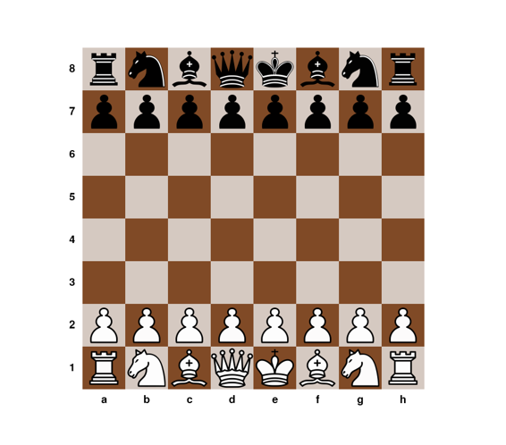
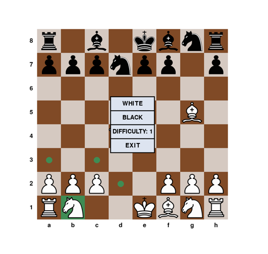

[](https://github.com/agresh775/Chess/actions/workflows/ci.yml)

# Шахматное приложение
Приложение состоит из двух частей - графического интерфейса (GUI) и шахматного движка. Графический интерфейс реализован на языке Python с помощью библиотеки Pygame.
Движок реализован на языке C++. Общение GUI и движка реализовано посредством универсального шахматного протокола (UCI).

## Использование

### 1. Клонирование репозитория

```bash
git clone https://github.com/agresh775/Chess.git
cd Chess
```

### 2. Установка зависимостей

#### Linux

```bash
sudo apt update && sudo apt install -y \
    python3-pip python3-venv \
    cmake ninja-build g++ \
    clang-format clang-tidy

python3 -m venv .venv && source .venv/bin/activate
pip install pygame ruff
```

#### Windows

```powershell
winget install Python.Python.3.13 Kitware.CMake Ninja-build.Ninja Chocolatey.Chocolatey
choco install mingw -y

py -m pip install pygame ruff
pip install clang-tools
clang-tools --install 23 --tool clang-format clang-tidy
```

### 3. Сборка

#### Linux

```bash
cd engine/src
python3 build.py
```

#### Windows

```powershell
cd engine\src
python build.py
```

### 4. Запуск

#### Linux

```bash
cd gui/src
python3 main.py
```

#### Windows

```powershell
cd gui\src
python main.py
```

### 5. Результат





## Документация

### UCI

Команды от GUI к движку:

1. uci - открыть сессию
2. ucinewgame - начало новой игры
3. isready - проверка готовности
4. position (startpos | fen `<FEN>`) [moves `<move1>` `<move2>` ...] - позиция игры в последовательных ходах с начала партии
6. go depth `<N>` - сделать ход с максимальной глубиной N
7. quit - закрыть сессию

Команды от движка к GUI:

1. id name ChessEngine - название
2. id author agresh775 - автор
3. uciok - сессия открыта
4. readyok - готов
5. bestmove `<move>` - лучший ход

### Правила

Все стандартные ходы шахматных фигур, рокировка, взятие на проходе.
Пешка может превратиться только в ферзя.
Мат, шах, пат возможны.
Ничья наступает при пате, 50 полуходах без взятий и ходов пешками, недостаточно материала (K vs K, K + B vs K, K + N vs K).

### Исходники

#### main.py

Здесь настраивается игровое окно, инициализируются игровое поле и настройки, запускается движок, обрабатывается взаимодействие с движком и пользователем.

#### board.py

Содержит класс Board для отрисовки игрового поля в соответствии с игровой позиции.

#### position.py

Cодержит класс Position для хранения игровой позиции и реализации правил игры.

#### setting.py

Cодержит класс Settings для хранения кнопок цвета, сложности, выхода из игры.

#### converter.py

Здесь находятся функции перевода числовых позиций классов Board и Position в стандартные шахматные обозначения и наоборот.

#### main.cpp

Здесь инициализируются игровая позиция, генератор случайных чисел для получения произвольного лучшего хода и обрабатывается взаимодействие с GUI.

#### position.hpp

Cодержит объявления класса Position и его методов анализа позиции и поиска возможных и лучших ходов.

#### position.cpp

Cодержит определения методов класса Position для анализа позиции и поиска возможных и лучших ходов.

#### piece.hpp

Здесь находится объявление класса Piece, описывающего шахматную фигуру,

#### piece.сpp

Здесь находятся конструктор класса Piece и функции, задающие операции шахматных фигур.

#### converter.hpp

Содержит объвления функций перевода числовых координат в текстовые и наоборот.

#### converter.cpp

Содержит определения функций перевода числовых координат в текстовые и наоборот.

